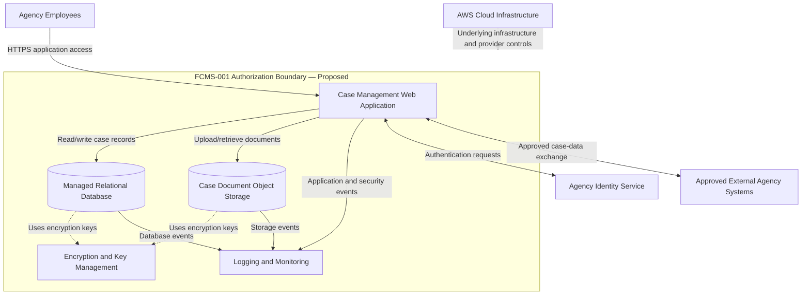

# FCMS-001 — System Boundary and Data Flow

**Document status:** Draft  
**Version:** 1.0  
**System ID:** FCMS-001

## Purpose

This diagram illustrates the proposed authorization boundary, primary data flows, and external dependencies for the fictional Federal Case Management System.

All components and flows are conceptual and have not been validated against a deployed environment.

## Architecture Diagram

## Boundary Notes

### Components proposed inside the boundary
- Case management application and runtime
- Managed database and case document storage
- System-specific identity and access configuration
- System-specific encryption configuration and key usage
- System-specific logging and monitoring

### External dependencies
- Underlying AWS infrastructure and provider-managed controls
- Agency identity services, if operated separately
- External agency systems exchanging approved case data
- Employee workstations and the general agency network

### Data Flow Summary

1. Agency employees access the web application over HTTPS.
2. The application authenticates users through the agency identity service, subject to the final identity architecture.
3. The application reads and writes case records in the managed database.
4. The application stores and retrieves supporting documents from object storage.
5. Application, database, and storage events are forwarded to the logging and monitoring capability.
6. Encryption and key-management services support protection of stored information.
7. Approved external systems exchange case information through defined interfaces.

## Limitations and Open Questions

- Specific AWS services and network components have not been selected.
- Authentication flows and trust relationships require further definition.
- The ownership of identity, encryption, logging, and monitoring controls remains to be determined.
- Network segmentation, ingress/egress controls, and administrative access paths require further design.
- External interfaces and their data classifications must be documented.
- The diagram does not establish that any security control is implemented or effective.
