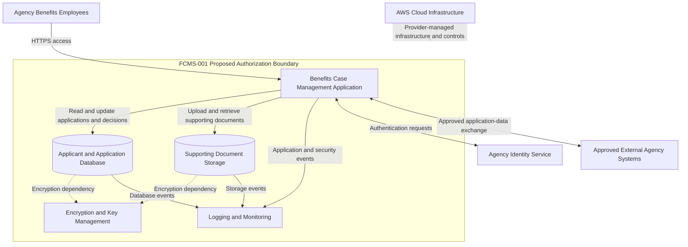

# FCMS-001 — System Boundary and Data Flow

**Document status:** Draft  
**Version:** 1.1  
**System ID:** FCMS-001

## 1. Purpose

This document illustrates the proposed authorization boundary, primary data flows, and external dependencies for the fictional Federal Benefits Case Management System.

The architecture is conceptual. All components and data flows are simulated and have not been validated against a deployed environment.

## 2. Proposed Architecture

## 3. Proposed Authorization Boundary

### Components Within Scope

- Benefits case management application and runtime.
- Managed database containing applicant information, application records, and eligibility decisions.
- Object storage containing supporting documents.
- System-specific identity and access configuration.
- System-specific encryption configuration and key usage.
- System-specific logging and monitoring configuration.
- Relevant deployment artifacts and administrative interfaces.

### External Dependencies

- Underlying AWS cloud infrastructure and provider-managed controls.
- Separately managed agency identity services, if applicable.
- Employee workstations and the general agency network.
- External agency systems exchanging approved application information.
- Organization-wide security services provided by separate control providers.

External dependencies remain relevant to the assessment. Their connections, ownership, and security responsibilities must be documented.

## 4. Primary Data Flows

1. Agency benefits employees access the application through a web interface using HTTPS.
2. The application exchanges authentication requests with the agency identity service, subject to the final identity architecture.
3. The application reads and updates applicant information, application records, and eligibility decisions in the managed database.
4. The application stores and retrieves supporting documents through object storage.
5. Application, database, and storage events are intended to be forwarded to logging and monitoring services.
6. Encryption and key-management capabilities are intended to protect stored information.
7. Approved external systems exchange application-related information through defined interfaces.

## 5. Security Considerations

- Applicant PII and supporting documents require appropriate confidentiality protections.
- Eligibility decisions and case histories require integrity and accountability protections.
- Authentication and authorization mechanisms must restrict access to approved users and roles.
- Security-relevant events should be available for investigation and monitoring.
- External connections and inherited controls must be considered when evaluating system risk.

These are assessment considerations, not verified control implementations or findings.

## 6. Open Questions

- Which specific AWS services and network components will be used?
- How will agency users authenticate, and how will privileged access be managed?
- Which party manages identity, encryption, logging, and monitoring controls?
- What external interfaces exist, and what information crosses each interface?
- What network segmentation and administrative access paths are required?
- Which controls are provided by AWS, the agency, or the system owner?
- What evidence will be available to demonstrate that relevant controls are implemented and effective?

## 7. Limitations

The diagram represents a proposed architecture for an educational simulation. It does not establish that any component or security control is deployed, configured, or effective.

The authorization boundary and data flows must be refined as system assumptions are validated.
